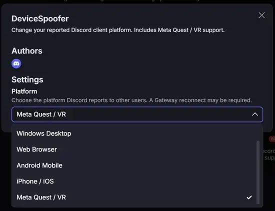

# DeviceSpoofer

A lightweight, unofficial **Vencord user plugin** that lets you change the client platform reported to Discord through its Gateway connection — including **Meta Quest / VR**.

> **Yes, this was vibe-coded because I was lazy.** 💀  
> Built for fun, not as a polished or security-audited product.

> [!IMPORTANT]
> This is a **client-platform** spoofer, not a hardware-ID spoofer or ban bypass. It's not affiliated with Discord, Meta, or Vencord. Discord can change how platform indicators work at any time. Using modified clients may violate Discord's Terms of Service.

## Screenshots

### Plugin settings



### Meta Quest / VR presence


*Screenshots supplied by the creator. The VR indicator was observed on their account; this doesn't guarantee identical behavior on every Discord version.*

## Features

- Change your reported platform from Vencord's plugin settings.
- Profiles for **Windows Desktop**, **Web Browser**, **Android Mobile**, **iPhone / iOS**, and **Meta Quest / VR**.
- **Disabled** option to use the normal platform again.
- No added external dependencies, telemetry, or authentication-token collection.
- No console/controller or smart-fridge modes — those presets were removed.

## Install

This plugin requires a **Vencord source build** (it is not compatible with the standard Vencord plugin installer by itself).

1. [Set up Vencord from source](https://docs.vencord.dev/installing/).
2. Download this repository as a ZIP or clone it **outside** your Vencord user plugins directory.
3. Copy the `deviceSpoofer` folder into `<Vencord>/src/userplugins/`.
4. Your final file should be `<Vencord>/src/userplugins/deviceSpoofer/index.ts`.
5. Open a terminal in the Vencord root and run:

   ```powershell
   pnpm install --frozen-lockfile
   pnpm build
   pnpm inject
   ```

6. Quit Discord completely and relaunch it.
7. Open **User Settings → Vencord → Plugins → DeviceSpoofer**, enable the plugin and pick a platform.

**Important:** Don't copy the full repository into `src/userplugins/`; only copy `deviceSpoofer`, otherwise the build may fail when Vencord tries to import the wrong folder.

[Official Vencord custom plugin guide](https://docs.vencord.dev/installing/custom-plugins/)

## Testing

Select **Meta Quest / VR**, reconnect or restart Discord, and check your account's presence icon **from another Discord account**. If the icon doesn't update immediately, fully restart Discord. Other clients or versions may interpret the platform properties differently.

To return to normal, choose **Disabled (Use Real Platform)** and reconnect/restart.

## Troubleshooting

- **`Could not resolve ./userplugins/...`**: check that `index.ts` is directly inside `src/userplugins/deviceSpoofer/`.
- **Plugin not listed**: ensure `pnpm build` succeeded, then restart Discord.
- **Indicator doesn't change**: try a full restart, verify from another account, and keep in mind Discord may reject or ignore particular platform identifiers.

## License

Licensed under **GPL-3.0-or-later**. See [LICENSE](LICENSE).

Made by **Babou**. Vibe-coded because manually coding everything sounded like effort. 😭
